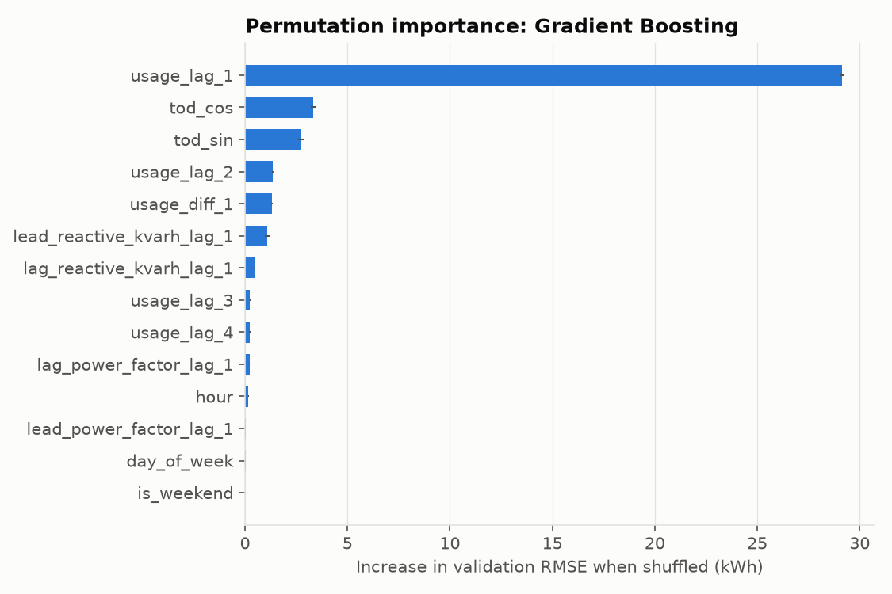
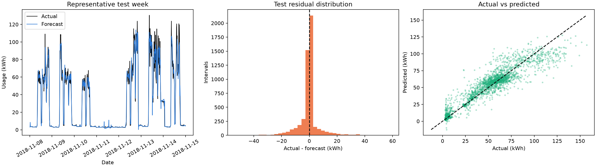
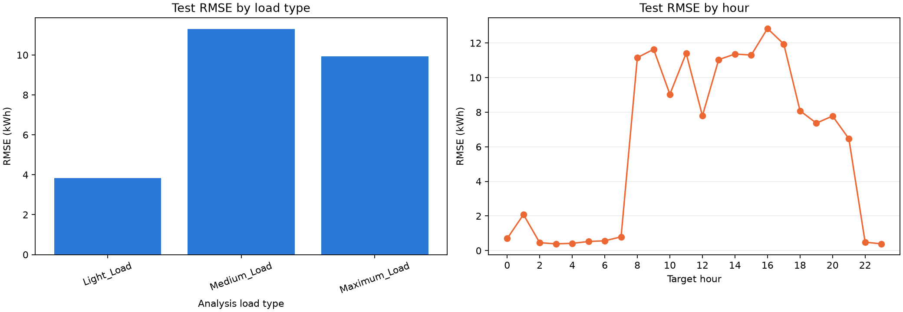

# Interpretation and Sustainability Analysis

## 1. Headline findings

1. **The plant has two operating states.** It is either near idle (about 3 kWh per interval) or in production (about 20–150 kWh).
2. **Idle intervals are common but cheap.** They are 58% of the time and 7.4% of the energy.
3. **Production hours dominate use.** Medium_Load and Maximum_Load periods use about 84% of the energy in half of the time.
4. **The forecast is strong overnight and weaker at the transitions.** Errors are largest when the plant starts up, takes a break or shuts down.
5. **Peaks are under-predicted.** For the top 10% of test intervals, the mean error is +7.85 kWh (actual − forecast).
6. **A forecast is not a saving.** Nothing here shows reduced energy use or emissions. Any benefit depends on actions staff take and must be measured.

## 2. How consumption behaves

### Two states, long right tail

- Median 4.75 kWh, mean 28.69 kWh, skewness 1.13.
- Consumption never falls below 2.48 kWh, so a base load is present at all hours.
- A single average describes neither state, so results are reported by regime and by hour as well as overall.

### Shift pattern

- Weekdays: about 5 kWh from 01:00 to 07:00, a jump at 08:00, about 70 kWh in the morning and afternoon blocks, and a sharp dip at 12:00 (23.5 kWh).
- Weekends: the same shape at a lower level, with no evening block. Saturday averages 16.66 kWh and Sunday 8.20 kWh.
- Of 1,574 jumps larger than 30 kWh between consecutive intervals, 606 happen at the 08:00, 12:00 and 13:00 endpoints.
- The midday dip looks like a break, but the data does not say so. This is a reading of the pattern, not a confirmed fact.

### Level drift over the year

- January averages about 4,500 kWh per day. From March to September the average is about 2,200–2,650 kWh per day.
- The lowest days fall in late July and August (minimum 268.0 kWh on 1 August). Possible reasons are holidays or reduced production, but no production records exist to check.

### Load types

| Load_Type | Share of intervals | Share of energy | Median kWh |
|---|---|---|---|
| Light_Load | 50.0% | 16.5% | 3.24 |
| Medium_Load | 28.6% | 36.9% | 31.20 |
| Maximum_Load | 21.4% | 46.7% | 58.07 |

The label is not a clean measure of consumption. 10.7% of Light_Load intervals exceed 20 kWh, and the label's definition is not documented.

### Electrical variables

- **CO2 is not an independent measurement.** It correlates with usage at r = 0.992, takes only eight values (0.00–0.07), is zero in 57.7% of intervals, and works out to about 0.43 kg CO2/kWh. It looks computed from usage and then rounded.
- **Power factor is low when the plant is idle.** The median lagging power factor is 63.95% at Light_Load, against 92.17% at Maximum_Load and 97.90% at Medium_Load. 81.3% of Light_Load intervals are below 90%.
- **Reactive energy is disproportionate at light load.** Light_Load uses 16.5% of the energy but carries 28.9% of the lagging reactive energy.
- **The recent past predicts the next interval best.** Autocorrelation is 0.909 at one interval, compared with 0.617 at one day and 0.674 at one week.

## 3. What the model has learned

- The model relies overwhelmingly on the last reading. Shuffling `usage_lag_1` raises validation RMSE by 29.13 kWh. Time of day is next (`tod_cos` +3.34, `tod_sin` +2.73).
- In practice the model tracks the plant's current state and adjusts it for the time of day.
- Seasonal lags (same time yesterday or last week) added nothing once the latest readings were known.
- **Limits of this view.** Importance shows association, not cause. Correlated lags share credit, so the low scores for `is_weekend` (0.02 kWh) and `day_of_week` (0.03 kWh) do not mean weekends are unimportant. The latest reading already reflects them. Importance was measured on September–November data only.

## 4. How well it works, and where it fails

Test period 8 November – 1 January (5,184 intervals), Gradient Boosting:

| Measure | Value |
|---|---|
| RMSE | 7.765 kWh (33.1% lower than persistence) |
| MAE | 3.723 kWh |
| R² | 0.938 |
| Mean error (actual − forecast) | −0.356 kWh |

- **Reliable when quiet.** Between 22:00 and 07:00 the hourly MAE is below 0.6 kWh. Light_Load MAE is 1.25 kWh.
- **Weaker when working.** Hourly MAE is about 4–8 kWh during working hours, highest around 08:00–09:00 and 16:00–17:00. This matches the sharp transitions in the daily profile.
- **Peaks are under-predicted.** For actual usage of 69.3 kWh or more (the top 10%, 520 intervals), RMSE is 17.12 kWh and the mean error is +7.85 kWh. Treat peak forecasts as a lower bound.
- **Months differ.** November RMSE is 9.14 kWh and December 6.56 kWh. This is descriptive and should not be read as a seasonal effect.
- **Scope.** This is one held-out period from one plant and one year, at a 15-minute horizon only.

## 5. Practical applications

| Insight | Possible use | Needed before claiming a benefit |
|---|---|---|
| Accurate forecasts outside working hours | Use the forecast as a short-term baseline. Flag intervals where overnight or weekend use is well above it. | Set a threshold on historical data and count real issues versus false alarms. |
| A constant base load of about 5 kWh per interval (about 20 kW) at night, 5.07 kWh on weekdays and 4.98 kWh at weekends | Audit what runs during idle hours. | Equipment-level metering, to separate necessary loads (safety, standby) from avoidable ones. |
| Medium and Maximum periods use about 84% of the energy | Focus scheduling and demand-management reviews on these blocks. | Production volume, so efficiency can be judged as kWh per unit produced. High use is not waste by default. |
| Low lagging power factor at light load | Review power-factor correction for idle periods. | A tariff and engineering assessment. This targets reactive charges and losses, not kWh. |
| Peaks are under-predicted | Add a safety margin and do not use the forecast alone as a peak alarm. | Longer horizons or a peak-specific model, tested on a held-out period. |
| CO2 column is derived from usage | Estimate emissions as kWh × a documented grid emission factor. | State the factor, its source and its year, and label the result an estimate. |

## 6. Sustainability link

The project fits **UTP Energy Security and SDG 7 (target 7.3, energy efficiency)**. The pathway is: forecast → better short-term visibility of demand → staff decision (review idle loads, schedule production, set alert thresholds) → possible energy saving. Only the first step has been built and tested. The other steps would need a pilot with an intervention, a baseline and metered results.

### Illustrative scenario (not a finding)

The idle-state baseline is the 51,268 kWh used in intervals below 10 kWh over the 251 training days (204 kWh per day). Part of this is necessary (safety, standby, lighting). The reductions below are assumptions chosen to show scale.

| Assumed cut in idle-state use | Energy over 251 days | Share of total plant use (691,368 kWh) | Emissions at 0.427 kg/kWh |
|---|---|---|---|
| 5% | 2,563 kWh | 0.37% | 1.1 t CO2 |
| 10% | 5,127 kWh | 0.74% | 2.2 t CO2 |
| 20% | 10,254 kWh | 1.48% | 4.4 t CO2 |

- The 0.427 kg/kWh figure is the ratio implied by the dataset's own CO2 column. It is unverified and is used only to show scale. A real estimate should use a documented grid factor for the plant's location and year.
- Even a 20% cut in idle use is about 1.5% of total consumption. Large savings, if any, would have to come from production periods, which this data cannot assess.

### Claims to avoid

- "The model reduces energy use by X%."
- "33% better accuracy means 33% less CO2."
- Calling high-consumption periods wasteful.
- Quoting any saving without its baseline, period and assumptions.

## 7. Limitations

1. **One plant, one year.** The data are from a South Korean steel plant in 2018. Results may not carry over to Malaysian plants or other years without local validation.
2. **No production context.** Output, product mix and maintenance records are missing, so efficiency and waste cannot be assessed.
3. **CO2 field.** It is rounded, derived from usage, and has inconsistent units in the source documentation. It cannot support emissions analysis.
4. **Load_Type.** Its definition is undocumented and it overlaps with consumption levels.
5. **Midnight timestamps.** The midnight interpretation is the team's assumption and has not been confirmed by the dataset authors.
6. **Horizon.** Only a 15-minute horizon was evaluated. Planning usually needs hours or a day ahead.
7. **Explanations are readings, not facts.** Breaks, shutdowns and holidays are plausible explanations of the patterns, not confirmed events.

## 8. Suggested next steps

1. Get production volume or shift schedules from the plant to turn kWh into an efficiency measure.
2. Replace the CO2 column with a documented grid emission factor for any emissions estimate.
3. Test longer forecast horizons and a peak-focused model.
4. Run a small pilot of the idle-load audit with sub-metering to measure any real saving.
5. Validate on data from another year or plant before using the results elsewhere.

## Sources in this repository

- Figures: `outputs/figures/eda_*.png` (training-period exploration, this author), `md_permutation_importance.png`, `mt_test_extended_diagnostics.png`, `mt_test_error_diagnostics.png`.
- Tables: `outputs/models/test_*.csv`, `permutation_importance_validation.csv`, `validation_comparison.csv`, `outputs/features/feature_group_ablation.csv`.
- Related reports: `member1`, `member2`, `member4` and `member5_report_sections.md`.
